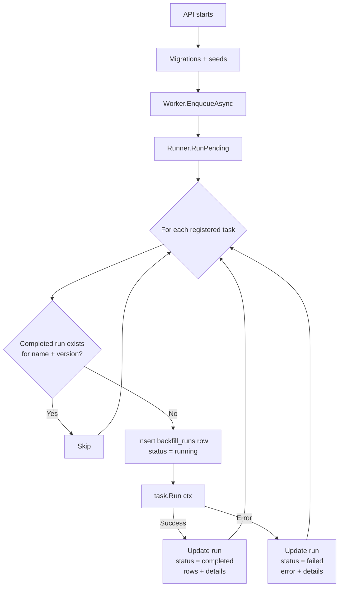

# Backfills

A **backfill** is a one-off data task that runs after code deploys. It is not a
recurring job and not a schema migration.

## When to use a backfill

| Change | Use |
| --- | --- |
| Add a column, index, or table | SQL migration in `internal/database/migrations` |
| Simple deterministic `UPDATE`/`INSERT` tied to a schema change | SQL migration |
| Logic that needs Go: hashing, creating users, calling a service or external API | Backfill task |
| Work that must be retried, audited, or forced manually | Backfill task |
| Recurring work (reminders, cache refresh, expiry) | `scheduleJobs` in `cmd/api/main.go` |

## Components

| Piece | Location | Responsibility |
| --- | --- | --- |
| Registry | `internal/backfills/registry.go` | Tasks keyed by name; validates uniqueness and version |
| Built-in tasks | `internal/backfills/tasks.go` | Registers the tasks for this deployment |
| Runner | `internal/backfills/runner.go` | Skips completed tasks, records runs, executes, retries failures |
| Ledger | `backfill_runs` (migration `000045`) | Execution history and status |
| Startup wiring | `cmd/api/main.go` (`scheduleJobs`) | Enqueues pending tasks on the background worker |
| CLI | `cmd/backfill` | `-list`, `-task`, `-force` for local/staging/container use |
| Makefile | `make backfill ARGS="..."` | Local convenience wrapper |

## Startup flow



The worker runs the pipeline asynchronously, so the HTTP server starts
immediately. A failed task has no completed row and is retried on the next API
start. A completed task is skipped until its version changes or an operator runs
it with `-force`.

## Ledger

`backfill_runs` keeps every execution:

| Column | Meaning |
| --- | --- |
| `name` | Task name (for example `historical_clients`) |
| `version` | Task version; default `1` |
| `status` | `running`, `completed` or `failed` |
| `started_at` / `finished_at` | Execution window |
| `rows_affected` | Rows the task reports as changed |
| `details` | Free-text summary (linked/skipped/errors, counts, notes) |
| `error` | Failure message |

`Runner.Statuses` maps each task to `pending`, `completed` or `failed` using the
latest run for its name and version. `cmd/backfill -list` prints that view.

## Versioning and idempotency

- Register tasks with a stable `Name` and start at `Version = "1"`.
- Change the version when the task must run again after deployment.
- A task should still be **idempotent**: multiple replicas can start at the same
  time and a partial run can be retried. The ledger prevents normal repeats but
  is not a distributed lock. For non-idempotent work, run a single replica or
  add a database advisory lock.
- `-force` bypasses the completed check and records a new run.

## Adding a backfill

1. Implement the logic in a service or repository with tests.
2. Register it in `internal/backfills/tasks.go`:

   ```go
   registry.Register(backfills.Task{
       Name:        "example_backfill",
       Version:     "1",
       Description: "What it changes",
       Run: func(ctx context.Context) (backfills.Result, error) {
           // call the service
           return backfills.Result{RowsAffected: n, Details: "..."}, nil
       },
   })
   ```

3. Add a test for the task or its service. `internal/backfills/runner_test.go`
   covers the ledger and skip/retry behavior.
4. Run `make backfill ARGS="-list"` and
   `make backfill ARGS="-task=example_backfill"` locally.
5. Update the OpenSpec change and this document if the mechanism changes.

No new `cmd/`, Docker step, or Makefile target is needed for a new backfill.

## Manual operations

```bash
# Local
make backfill ARGS="-list"
make backfill ARGS="-task=historical_clients"
make backfill ARGS="-task=historical_clients -force"

# Inside a running container (the image includes the backfill binary)
docker exec -it <container> ./backfill -list
docker exec -it <container> ./backfill -task=historical_clients -force
```

## Reference task: historical clients

`historical_clients` links migrated sales to real customer accounts. It uses
`HistoricalSaleService.BackfillClients`, which is idempotent and processes only
rows with `client_user_id IS NULL`. The task records linked, skipped and error
counts in `details`. See the `link-historical-clients-to-users` OpenSpec change
and [data model](data-model.md).

## Reference task: legacy identity documents

`legacy_identity_documents` exposes the files that were attached to a contract
before the identity documents existed, so the staff can open them from the
contract view. It uses `IdentityDocumentService.MigrateLegacyDocuments`.

- It counts first. With no contract carrying a non-empty
  `contracts.document_paths` it returns `rows_affected = 0` and the detail
  `nothing to migrate: no contract carries legacy document paths`, and it
  creates nothing.
- Each stored file becomes one `contract_identity_documents` row with
  `source = 'legacy'`, `kind = NULL` and the metadata read from the file. The
  row points at the path that is already on disk; no file is copied or moved.
- It is idempotent: a contract that already has a legacy row for a path is
  skipped. The `details` string reports `contracts`, `created`, `skipped`,
  `missing_files` and `errors`.
- A missing file still gets a row (`missing_files` is incremented), so the loss
  is visible instead of silent. The entries are read-only and are never
  promoted to a person-level document.

## Related

- [Operations guide](../guides/operations.md#backfills)
- [Domain flows](domain-flows.md)
- [Data model](data-model.md)
