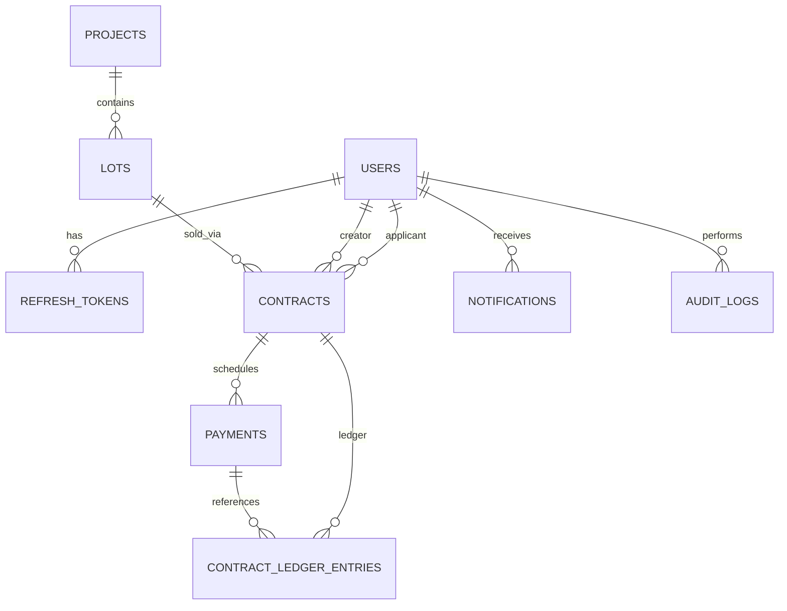

# Data Model

Schema source of truth: `internal/database/migrations/*.up.sql`.
Model definitions: `internal/models/*.go`.

## Entity relationships

## Tables

### `users`

Accounts and profile data. Soft deletion uses `discarded_at` (no GORM
`DeletedAt`).

Key columns: `email` (unique), `encrypted_password`, `role` (`admin`,
`seller`, `user`), `status` (`active`, `inactive`, `suspended`), `full_name`,
`phone`, `identity` (unique), `rtn` (unique), `credit_score`, `locale`
(`es`, `en`), `must_change_password`, `profile_picture`,
`profile_picture_thumb`, `created_by`, `discarded_at`.

### `refresh_tokens`

DB-backed refresh tokens, 30-day expiry. A row is deleted when used (rotation)
or on logout.

### `projects`

Real-estate projects with pricing and commission configuration.

Key columns: `name`, `description`, `project_type`, `address`, `city`, `code`,
`lot_count`, `price_per_square_unit`, `interest_rate` (percentage, used for
overdue interest), `guid`, `commission_rate`, `commission_rate_direct`
(default 4), `commission_rate_bank` (default 6), `commission_rate_cash`
(default 7), `measurement_unit`, `delivery_date`, `is_published`, `is_active`.

`city` and `code` are optional discovery fields managed by admins. The public
catalog also derives `price_from` / `price_to` from the effective lot prices and
`drawing_count` from the project's drawings; it never exposes interest or
commission rates.

### `lots`

Individual lots inside a project.

Key columns: `project_id`, `name`, `status` (`available`, `reserved`,
`financed`, `fully_paid`, `active`), `length`, `width`, `price`,
`override_price`, `override_area`, `measurement_unit`, `registration_number`,
`address`, `note`, boundary strings (`north`, `south`, `east`, `west`).

Derived helpers: `Area()` uses `override_area` when set, otherwise
`length × width`; `EffectivePrice()` uses `override_price` when set, otherwise
`price`.

### `contracts`

Sales contracts linking an applicant to a lot.

Key columns: `lot_id`, `creator_id`, `applicant_user_id`, `payment_term`,
`guid`, `financing_type` (`direct`, `bank`, `cash`), `status`, `amount`,
`balance`, `commission_amount`, `down_payment`, `reserve_amount`,
`max_payment_date` (required for cash, seller-managed for bank), `bank_name`,
`bank_credit_status` (customer-reported loan stage), `currency` (default
`HNL`), `approved_at`, `active`, `note`, `rejection_reason`, `document_paths`,
`closed_at`, `created_at`.

`balance` is a cached copy of the ledger balance. The ledger is authoritative;
`PaymentService.updateContractBalance` refreshes it.

### `payments`

Scheduled installments and ad-hoc repayment records.

Key columns: `contract_id`, `amount`, `paid_amount`, `due_date`,
`payment_date`, `status`, `payment_type`, `description`, `interest_amount`,
`approved_at`, `approved_by_user_id`, `rejection_reason`, `document_path`,
`overdue_reminder_sent_at`, `upcoming_reminder_sent_at`.

Payment types: `reservation`, `down_payment`, `installment`, `full`,
`advance`, `capital_repayment`.

### `contract_ledger_entries`

Append-only financial ledger. Contract balance is the sum of entries.

Key columns: `contract_id`, `payment_id`, `amount`, `description`,
`entry_type`, `entry_date`.

| Entry type | Sign in code | Meaning |
| --- | --- | --- |
| `initial` | negative | Contract principal as debt |
| `payment` | positive | Approved payment reduces debt |
| `interest` | negative | Overdue interest increases debt |
| `prepayment` | positive | Capital repayment reduces debt |
| `adjustment` | either | Reversal or manual correction |

> The comment in `internal/models/contract_ledger_entry.go` says the opposite
> sign convention. Trust the implementation: negative increases debt,
> positive reduces it.

### `notifications`

In-app notifications. `read_at` is `NULL` until read. Type constants live in
`internal/models/common.go` (contract/payment/lot/system events).

### `audit_logs`

Manual audit trail written by `AuditService.Log` from services.

Key columns: `user_id`, `action`, `entity`, `entity_id`, `details`, `ip_address`,
`user_agent`, `created_at`.

### `analytics_cache`

JSONB cache for analytics results with an expiry timestamp. Filtered requests
bypass the cache; dashboard requests use a 15-minute TTL.

### `branding_settings`

Singleton row (`CHECK (id = 1)`) holding the global application branding:
`app_name` (default `Fintera`), `logo_path`, `logo_dark_path` (relative paths
under `STORAGE_PATH`, served publicly at `/uploads/branding/...`). Read by
anyone via `GET /api/v1/branding`; changed only by admins. Logo files live on
the `STORAGE_PATH` volume, which must be persistent in production.

## Enumerations

| Enum | Values |
| --- | --- |
| `users.role` | `admin`, `seller`, `user` |
| `users.status` | `active`, `inactive`, `suspended` |
| `projects.project_type` | `residential` (default) |
| `lots.status` | `available`, `reserved`, `financed`, `fully_paid`, `active` |
| `contracts.status` | `pending`, `submitted`, `approved`, `signed`, `rejected`, `cancelled`, `closed` |
| `contracts.financing_type` | `direct`, `bank`, `cash` |
| `contracts.bank_credit_status` | `not_started`, `pre_qualified`, `pre_approved`, `approved` |
| `payments.status` | `pending`, `submitted`, `paid`, `rejected`, `readjustment` |
| `payments.payment_type` | `reservation`, `down_payment`, `installment`, `full`, `advance`, `capital_repayment` |
| ledger `entry_type` | `initial`, `payment`, `interest`, `prepayment`, `adjustment` |

`contracts.status` includes `signed` in the model constants, but no transition
currently produces it.

## Migrations

Migrations are ordered SQL pairs in `internal/database/migrations/` and managed
with golang-migrate:

| Version | Change |
| --- | --- |
| 000001 | Initial consolidated schema |
| 000002 | `payments.approved_by_user_id` |
| 000003 | `contracts.max_payment_date` |
| 000004 | `analytics_cache` |
| 000005 | `payments.rejection_reason` |
| 000006 | `users.must_change_password` |
| 000007 | `payments.overdue_reminder_sent_at` |
| 000008 | `payments.upcoming_reminder_sent_at` |
| 000009 | Commission fields |
| 000010 | Profile picture fields |
| 000011 | `contracts.guid` |
| 000012 | `contracts.created_at` index |
| 000021 | `contracts.bank_name`, `contracts.bank_credit_status` |

Applied migrations are immutable. Add a new numbered pair instead of editing
history.

## Seeds

- `internal/database/seeds/seeds.sql`
- `internal/database/seeds/overdue_contract_seed.sql`

Run with `make seed`, or use `make drop-db-seed-migrate` to recreate a local
database. The Docker image runs `make migrate-up && make seed` on start.
