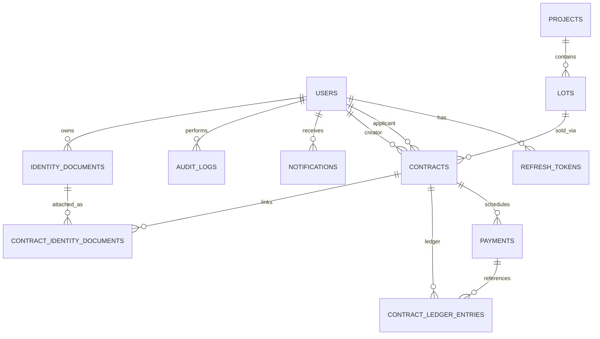

# Data Model

Schema source of truth: `internal/database/migrations/*.up.sql`.
Model definitions: `internal/models/*.go`.

## Entity relationships

## Tables

### `users`

Accounts and profile data. Soft deletion uses `discarded_at` (no GORM
`DeletedAt`).

Key columns: `email` (unique), `encrypted_password`, `role` (`admin`,
`seller`, `user`), `status` (`active`, `inactive`, `suspended`), `full_name`,
`phone`, `identity` (unique for non-empty values), `rtn` (unique for non-empty
values), `credit_score`, `locale` (`es`, `en`), `must_change_password`,
`profile_picture`, `profile_picture_thumb`, `created_by`, `discarded_at`.

Uniqueness of `identity` and `rtn` is enforced by partial unique indexes
(`idx_users_identity_unique`, `idx_users_rtn_unique`) that exclude `NULL` and
empty strings (migration `000046`). Clients without a tax id or identity —
e.g. historical clients created from CSV imports — are stored as `NULL` and
never collide with each other.

### `refresh_tokens`

DB-backed refresh tokens, 30-day expiry. A row is deleted when used (rotation)
or on logout.

### `projects`

Real-estate projects with pricing and commission configuration.

Key columns: `name`, `description`, `project_type`, `address`, `city`, `code`,
`lot_count`, `price_per_square_unit`, `interest_rate` (percentage, used for
overdue interest), `guid`, `commission_rate`, `commission_rate_direct`
(default 4), `commission_rate_bank` (default 6), `commission_rate_cash`
(default 7), `measurement_unit`, `delivery_date`, `is_published`, `is_active`.

`city` and `code` are optional discovery fields managed by admins. The public
catalog also derives `price_from` / `price_to` from the effective lot prices and
`drawing_count` from the project's drawings; it never exposes interest or
commission rates.

`guid` is the public identifier used by portal URLs and media endpoints. It is
`NOT NULL`, uniquely indexed, and defaults to `gen_random_uuid()::text`; legacy
rows are backfilled by migration `000024`.

### `lots`

Individual lots inside a project.

Key columns: `project_id`, `name`, `status` (`available`, `reserved`,
`financed`, `fully_paid`, `active`), `length`, `width`, `price`,
`override_price`, `override_area`, `measurement_unit`, `registration_number`,
`address`, `note`, boundary strings (`north`, `south`, `east`, `west`).

Derived helpers: `Area()` uses `override_area` when set, otherwise
`length × width`; `EffectivePrice()` uses `override_price` when set, otherwise
`price`.

### `contracts`

Sales contracts linking an applicant to a lot.

Key columns: `lot_id`, `creator_id`, `applicant_user_id`, `payment_term`,
`guid`, `financing_type` (`direct`, `bank`, `cash`), `status`, `amount`,
`balance`, `commission_amount`, `down_payment`, `reserve_amount`,
`max_payment_date` (required for cash, seller-managed for bank), `bank_name`,
`bank_credit_status` (customer-reported loan stage), `currency` (default
`HNL`), `approved_at`, `active`, `note`, `rejection_reason`, `document_paths`,
`closed_at`, `created_at`, `submitted_at`, `rejected_at`.

`balance` is a cached copy of the ledger balance. The ledger is authoritative;
`PaymentService.updateContractBalance` refreshes it.

### `project_payment_instructions`

Bank accounts a project offers to customers for reservation payments. Managed by
admins through `/api/v1/projects/:project_id/payment-instructions` and exposed
publicly (published projects only) through
`/api/v1/public/projects/:guid/payment-instructions`.

Key columns: `project_id`, `bank_name`, `beneficiary_name`, `account_number`,
`account_type` (`savings`, `checking`), `notes`, `position`, timestamps. Rows
are ordered by `position, id`.

The public payload only exposes `bank_name`, `beneficiary_name`,
`account_number`, `account_type` and `notes`; ids, positions and timestamps stay
admin-only. Limits enforced by the service: bank 120, beneficiary 160, account
number 60 and notes 500 characters.

### `payments`

Scheduled installments and ad-hoc repayment records.

Key columns: `contract_id`, `amount`, `paid_amount`, `due_date`,
`payment_date`, `status`, `payment_type`, `description`, `interest_amount`,
`approved_at`, `approved_by_user_id`, `rejection_reason`, `document_path`,
`overdue_reminder_sent_at`, `upcoming_reminder_sent_at`.

Payment types: `reservation`, `down_payment`, `installment`, `full`,
`advance`, `capital_repayment`.

### `contract_ledger_entries`

Append-only financial ledger. Contract balance is the sum of entries.

Key columns: `contract_id`, `payment_id`, `amount`, `description`,
`entry_type`, `entry_date`.

| Entry type | Sign in code | Meaning |
| --- | --- | --- |
| `initial` | negative | Contract principal as debt |
| `payment` | positive | Approved payment reduces debt |
| `interest` | negative | Overdue interest increases debt |
| `prepayment` | positive | Capital repayment reduces debt |
| `refund` | negative | Refund on cancellation (reverses a payment) |
| `adjustment` | either | Reversal or manual correction |

> The comment in `internal/models/contract_ledger_entry.go` says the opposite
> sign convention. Trust the implementation: negative increases debt,
> positive reduces it.

### `identity_documents`

A person's identity documents: at most one row per `(user_id, kind)`, with
`kind` in (`dni`, `rtn`). This is the single place a DNI or RTN file path
lives, so every contract of that applicant shows the same two documents.

Key columns: `user_id`, `kind`, `file_path`, `preview_path`,
`original_filename`, `mime_type`, `size_bytes`, `uploaded_by`, timestamps.

Unique: `(user_id, kind)`. A new upload of a kind replaces the row and deletes
the replaced `file_path` and `preview_path`; there is no version history.
`preview_path` is a downscaled WebP copy and is `NULL` for `application/pdf`,
`image/heic` and `image/heif`, which the API does not decode.

### `contract_identity_documents`

Links a contract to the identity documents of its applicant, and carries the
files that were attached to a contract before this feature existed.

Key columns: `contract_id`, `identity_document_id`, `kind`, `source`,
`file_path`, `original_filename`, `mime_type`, `size_bytes`, `created_at`.

`source` is `upload` for a link to a person-level document and `legacy` for a
migrated file taken from `contracts.document_paths`. Legacy rows have
`kind = NULL` and `identity_document_id = NULL` because nothing says which file
was the DNI, so they are read-only, contract-scoped, and never promoted to a
person-level document.

Unique: `(contract_id, kind)`. PostgreSQL treats `NULL` as distinct, so several
legacy rows coexist in one contract while two rows claiming the same kind do
not.

### `seller_commission_credits`

Recoverable commission credit created when a contract whose commission was
already paid is cancelled. Key columns: `seller_id`, `contract_id`, `amount`,
`status` (`pending`/`settled`), `created_at`, `settled_at`, `settled_by`.

### `notifications`

In-app notifications. `read_at` is `NULL` until read. Type constants live in
`internal/models/common.go` (contract/payment/lot/system events).

### `audit_logs`

Manual audit trail written by `AuditService.Log` from services.

Key columns: `user_id`, `action`, `entity`, `entity_id`, `details`, `ip_address`,
`user_agent`, `created_at`.

`user_id` is nullable (migration `000043`). Entries written without an
authenticated actor (jobs, unauthenticated flows) pass `services.SystemAuditActor`
(`0`), which is stored as `NULL`.

### `analytics_cache`

JSONB cache for analytics results with an expiry timestamp. Filtered requests
bypass the cache; dashboard requests use a 15-minute TTL (30 minutes for
performance). Writes are atomic upserts keyed by `(cache_key, project_id)`; the
global scope uses a partial unique index on `cache_key` where `project_id` is
`NULL`.

### `branding_settings`

Singleton row (`CHECK (id = 1)`) holding the global application branding:
`app_name` (default `Fintera`), `logo_path`, `logo_dark_path` (relative paths
under `STORAGE_PATH`, served publicly at `/uploads/branding/...`). Read by
anyone via `GET /api/v1/branding`; changed only by admins. Logo files live on
the `STORAGE_PATH` volume, which must be persistent in production.

### `general_settings`

Singleton row (`id = 1`) with the deployment-wide customer settings:

- `support_whatsapp` — E.164-ish number (`+504...`) shown in the customer portal.
- `support_email` — optional support email.
- `reservation_hold_hours` — lot-hold duration, default `48` (1–720). Drives
  `hold_expires_at` on pending reservations and the reservation payment due date.

Read publicly via `GET /api/v1/settings`; updated only by admins via
`PUT /api/v1/settings`.

## Enumerations

| Enum | Values |
| --- | --- |
| `users.role` | `admin`, `seller`, `user` |
| `users.status` | `active`, `inactive`, `suspended` |
| `projects.project_type` | `residential` (default) |
| `lots.status` | `available`, `reserved`, `financed`, `fully_paid`, `active` |
| `contracts.status` | `pending`, `submitted`, `approved`, `signed`, `rejected`, `cancelled`, `closed` |
| `contracts.financing_type` | `direct`, `bank`, `cash` |
| `contracts.bank_credit_status` | `not_started`, `pre_qualified`, `pre_approved`, `approved` |
| `project_payment_instructions.account_type` | `savings`, `checking` |
| `payments.status` | `pending`, `submitted`, `paid`, `rejected`, `readjustment`, `cancelled` |
| `payments.payment_type` | `reservation`, `down_payment`, `installment`, `full`, `advance`, `capital_repayment` |
| ledger `entry_type` | `initial`, `payment`, `interest`, `prepayment`, `refund`, `adjustment` |
| `identity_documents.kind` | `dni`, `rtn` |
| `contract_identity_documents.kind` | `dni`, `rtn`, or `NULL` for a legacy file |
| `contract_identity_documents.source` | `upload`, `legacy` |

`contracts.status` includes `signed` in the model constants, but no transition
currently produces it.

## Migrations

Migrations are ordered SQL pairs in `internal/database/migrations/` and managed
with golang-migrate:

| Version | Change |
| --- | --- |
| 000001 | Initial consolidated schema |
| 000002 | `payments.approved_by_user_id` |
| 000003 | `contracts.max_payment_date` |
| 000004 | `analytics_cache` |
| 000005 | `payments.rejection_reason` |
| 000006 | `users.must_change_password` |
| 000007 | `payments.overdue_reminder_sent_at` |
| 000008 | `payments.upcoming_reminder_sent_at` |
| 000009 | Commission fields |
| 000010 | Profile picture fields |
| 000011 | `contracts.guid` |
| 000012 | `contracts.created_at` index |
| 000015 | `project_payment_instructions` |
| 000021 | `contracts.bank_name`, `contracts.bank_credit_status` |
| 000022 | `general_settings` |
| 000023 | `contracts.submitted_at`, `contracts.rejected_at` |
| 000024 | `projects.guid` backfill + default |
| 000026 | `payments.amount`, `payments.interest_amount` widened to `NUMERIC(15,2)` |
| 000041 | Analytics indexes and cache uniqueness |
| 000042 | `payments(contract_id, due_date)` index |
| 000047 | `identity_documents` and `contract_identity_documents` |

Applied migrations are immutable. Add a new numbered pair instead of editing
history.

The analytics workload relies on `idx_payments_payment_date`,
`idx_payments_status_payment_date`, `idx_contracts_status_active_lot`, and
`idx_lots_project_status`; `idx_analytics_cache_key_project` is unique and
`idx_analytics_cache_global_key` is a partial unique index for the global cache
scope. `idx_payments_contract_due_date` on `payments(contract_id, due_date)`
covers contract payment history, overdue-reminder lookups, and any query that
filters by contract and sorts by due date.

## Seeds

- `internal/database/seeds/seeds.sql`
- `internal/database/seeds/overdue_contract_seed.sql`

Run with `make seed`, or use `make drop-db-seed-migrate` to recreate a local
database. The Docker image runs `make migrate-up && make seed` on start.
