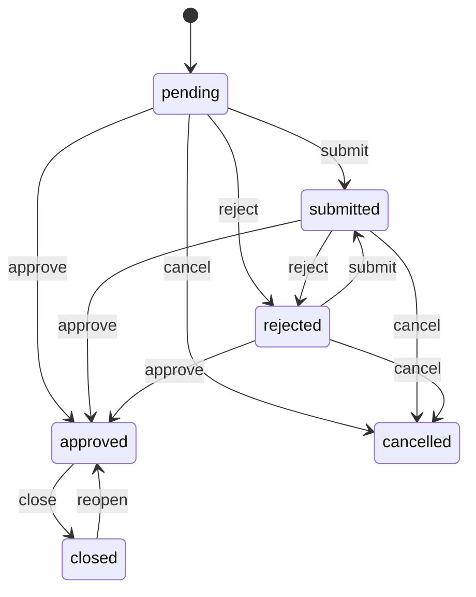
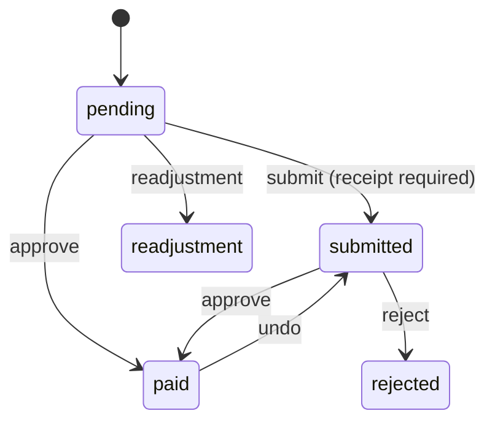

# Domain Flows

Business logic lives in `internal/services`. State transitions are validated by
`internal/statemachine` before services persist changes.

## Contract lifecycle

FSM source: `internal/statemachine/contract_fsm.go`.
Model guards: `Contract.MaySubmit`, `MayApprove`, `MayReject`, `MayCancel`,
`MayClose`, `MayReopen`.

### Approve (`ContractService.Approve`)

1. Load contract with lot, project, applicant, payments, ledger.
2. Validate and apply the FSM `approve` transition.
3. Set `approved_at`, `active = true`.
4. Create the initial ledger entry with `amount = -contract.Amount`
   (`entry_type = initial`) if an amount is set.
5. Generate and persist the payment schedule.
6. Set the lot to `reserved`.
7. Enqueue notification + approval email asynchronously.
8. Write an audit log entry.

### Reject (`ContractService.Reject`)

- FSM `reject`, store `rejection_reason`.
- Release the lot back to `available`.
- Enqueue in-app notification and best-effort rejection email.
- Audit log.

### Cancel (`ContractService.Cancel`)

- FSM `cancel`, store note, set `active = false`.
- Delete `pending`/`submitted` payments for the contract.
- Delete all ledger entries for the contract.
- Release the lot to `available`.
- Audit log.

### Close (`ContractService.Close`)

- Recalculate ledger balance; requires `balance >= 0`.
- FSM `close`, set `closed_at`.
- Set lot to `fully_paid`.
- Enqueue completion notification.
- Audit log.

Contracts are also auto-closed by `PaymentService.updateContractBalance` when
the balance reaches `>= 0` and status is `approved`.

### Reopen

FSM `closed → approved`. Used to correct prematurely closed contracts.

### Capital repayment (`ContractService.CapitalRepayment`)

Used by `POST .../capital_repayment` (admin). It:

1. Requires an `approved` contract and `amount > 0`.
2. Creates a `capital_repayment` payment record (status `paid`).
3. Creates a positive `prepayment` ledger entry linked to that payment.
4. Applies the amount to pending installments from the **last to first**:
   fully covered installments are deleted, a partially covered installment has
   its amount reduced.
5. Refreshes the contract balance and auto-closes when balance `>= 0`.
6. Writes an audit log.

`ContractService.ApplyPrepayment` implements a simpler ledger-only prepayment
that also closes the contract at balance `>= 0`.

### Reservation release

`ContractService.ReleaseUnpaidReservations` finds contracts with unpaid
reservations older than 48 hours (`FindPendingReservations`) and cancels them
with the note `"Reservación no pagada a tiempo"`.

## Payment lifecycle

FSM source: `internal/statemachine/payment_fsm.go`.
Model guards: `Payment.MaySubmit`, `MayApprove`, `MayReject`, `MayUndo`.

### Payment schedule generation

`PaymentScheduleService.GenerateSchedule` runs on contract approval.

**Bank or cash financing** (`max_payment_date` required):

1. Reservation payment, due in 7 days, if `reserve_amount > 0`.
2. Remaining amount (`amount - reserve_amount`) due on `max_payment_date`,
   type `full`.

**Direct financing:**

1. Reservation payment, due in 7 days, if `reserve_amount > 0`.
2. Down payment, due in 14 days (21 days if a reservation exists), if
   `down_payment > 0`.
3. `payment_term` installments starting one month after approval. Base
   installment is `floor(remaining / term)`; the first installment absorbs the
   remainder so there are no cents in later installments.
4. If `remaining > 0` and `payment_term == 0`, create one `full` payment due in
   one month.

### Approve (`PaymentService.Approve`)

1. Validate state (`MayApprove`) and default `paid_amount` to
   `amount + interest_amount`.
2. Set status `paid`, `paid_amount`, `payment_date`, `approved_at`,
   `approved_by_user_id`.
3. Compute overpayment (`paid_amount - amount - interest_amount`).
4. Apply overpayment to pending/submitted payments from last to first,
   deleting fully covered installments and reducing a partial one. Future
   interest is not prepaid.
5. Create a positive `payment` ledger entry for the regular amount.
6. Create a positive `prepayment` ledger entry for any capital portion.
7. Async: set lot to `financed` when this is a reservation payment, refresh
   contract balance (and auto-close if paid off).
8. Async: notification + approval email.
9. Audit log.

`PaymentService.ApprovePaymentWithLedger` is a simpler variant used internally;
it creates one positive `payment` entry and enqueues a notification.

### Reject

FSM `reject`, store `rejection_reason`, enqueue notification and rejection
email, audit log.

### Undo

FSM `undo` (`paid → submitted`). Creates an opposite-sign `adjustment` ledger
entry, clears `paid_amount`/`payment_date`/`approved_at`, notifies the user.
For contracts already auto-closed, reopen manually if needed.

### Readjustment

FSM `pending → readjustment`, used to mark a payment that needs re-terming.

### Overdue interest

`PaymentService.CalculateOverdueInterest`:

- Only `installment` payments on `approved`, `active` contracts.
- `interest = payment.amount × days_overdue / 365 × (project.interest_rate / 100)`.
- Writes/updates a **negative** `interest` ledger entry per payment via
  `FindOrCreateByPaymentAndType`, so the entry always reflects the current
  accumulated interest instead of accumulating duplicates.
- Updates `payments.interest_amount` for display.
- Notifies admins with a summary when any interest was calculated.

## Background jobs

Scheduled in `cmd/api/main.go` (`scheduleJobs`) with
`Worker.ScheduleEveryImmediate`, which runs once at startup then at the given
interval.

| Interval | Job | Function |
| --- | --- | --- |
| 12 hours | Overdue interest + notifications | `Payment.CalculateOverdueInterest`, `Payment.CheckOverduePayments` |
| 8 hours | Credit scores | `CreditScore.UpdateAllScores` |
| 15 minutes | Analytics cache refresh | `Analytics.RefreshCache` |
| 8 hours | Release unpaid reservations | `Contract.ReleaseUnpaidReservations` |
| 24 hours | Payment reminder emails | `Payment.SendDailyPaymentReminderEmails`, `Payment.SendDailyUpcomingPaymentReminderEmails` |

Worker characteristics (`internal/jobs/worker.go`):

- Buffered queue of 100 jobs, `WORKER_COUNT` consumers.
- `EnqueueAsync` is fire-and-forget with a bounded semaphore (2× workers, min
  10).
- Every job path (queued, async, scheduled, one-off) runs through `execute`,
  which converts panics into errors, reports them to Rollbar, and keeps the
  worker alive.
- `ScheduleEvery` waits for the first interval; `ScheduleEveryImmediate` does
  not.
- Stats are exposed by `GET /api/v1/jobs/status` (admin).

## Reports and exports

`ReportService` uses embedded Go templates:

- Email templates: `internal/services/templates/email/*.html`
- Report templates: `internal/services/templates/reports/*.html`

CSV reports: commissions, total revenue, overdue payments.
PDF reports: user balance, contract promise, rescission, user information
(reuses balance PDF), customer record. PDFs are rendered with
`go-wkhtmltopdf`, so the `wkhtmltopdf` binary must be installed (the Docker
image includes it).

Analytics exports (`ExportService`) support CSV, XLSX, and PDF.

## Notifications and email

- `NotificationService.NotifyUser` inserts an in-app notification.
- `NotificationService.NotifyAdmins` fans out to all admins.
- `EmailService` renders embedded HTML templates and sends through Resend.
- Email is skipped when `ENABLE_EMAIL_NOTIFICATIONS=false`; it also fails
  gracefully with a clear log message when `RESEND_API_KEY` or `FROM_EMAIL` is
  missing.

Service integration points: contract approved/rejected/submitted, payment
approved/rejected, reservation approved, overdue/upcoming reminders, password
recovery, and account creation.

## File storage

`internal/storage/local.go` stores files under `STORAGE_PATH`:

- Receipts: `receipts/YYYY/MM/<random-id>.<ext>`
- Contract documents: `contracts/YYYY/MM/...`
- Profile pictures: `uploads/...`

Only `application/pdf`, `image/jpeg`, `image/jpg`, and `image/png` are allowed;
the maximum size is 10 MB. `SafeFullPath` prevents path traversal on download.
DB rows store relative paths only.

## Credit score

`CreditScoreService.UpdateScore` recalculates a user score from payment
history and contract behavior. `UpdateAllScores` iterates users and is scheduled
every 8 hours.

## Analytics cache

`AnalyticsService.GetOverview` uses `analytics_cache` with a 15-minute TTL for
dashboard-style requests. Requests carrying date or year filters bypass the
cache so filtered analytics are always fresh. `RefreshCache` is scheduled every
15 minutes.
