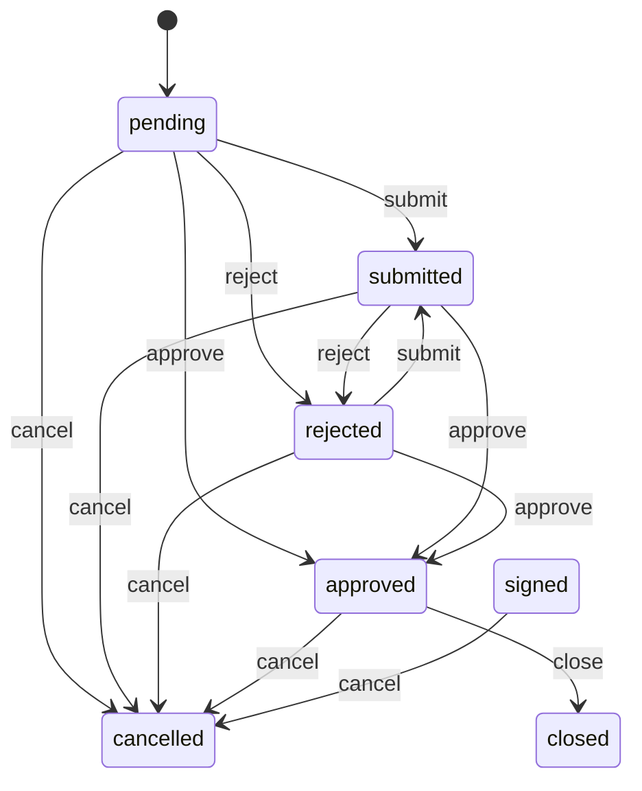
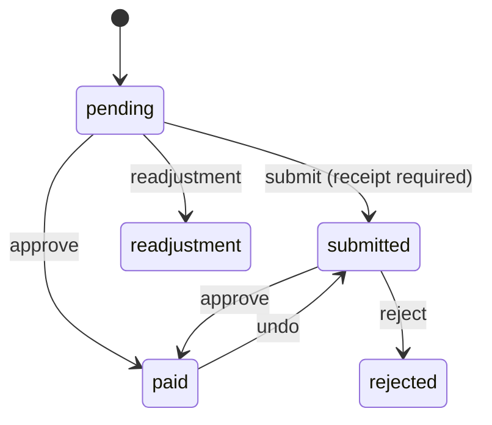

# Domain Flows

Business logic lives in `internal/services`. State transitions are validated by
`internal/statemachine` before services persist changes.

## Contract lifecycle

FSM source: `internal/statemachine/contract_fsm.go`.
Model guards: `Contract.MaySubmit`, `MayApprove`, `MayReject`, `MayCancel`,
`MayClose`.

### Creation and the identity documents

`ContractService.CreateWithIdentityDocuments` is the single entry point of both
the staff endpoint (`POST /projects/:project_id/lots/:lot_id/contracts`) and the
public reservation endpoint
(`POST /public/projects/:guid/lots/:lot_guid/contracts`). Before anything is
written it:

1. validates every uploaded file (10 MB, allowed type) and answers `422`
   naming the offending file instead of dropping it silently;
2. when `IDENTITY_DOCUMENTS_REQUIRED=true`, computes the kinds missing from the
   applicant's `identity_documents` plus the ones in the request, and answers
   `422` with `code: IDENTITY_DOCUMENTS_REQUIRED` and a `missing` array;
3. fills only the empty slots, keeping a document that is already on file and
   reporting its kind in `already_present`;
4. creates the contract and its `contract_identity_documents` links in one
   transaction, and exposes each free-form `documents[N]` attachment of the
   request as a read-only legacy entry, so the staff sees what the customer
   attached without waiting for the one-off migration task.

Replacing a document is an explicit act: it only happens through the upload
endpoint, never as a side effect of creating a contract.

### Approve (`ContractService.Approve`)

1. Load contract with lot, project, applicant, payments, ledger.
2. Validate and apply the FSM `approve` transition.
3. Set `approved_at`, `active = true`.
4. Create the initial ledger entry with `amount = -contract.Amount`
   (`entry_type = initial`) if an amount is set.
5. Generate and persist the payment schedule.
6. Set the lot to `reserved`.
7. Enqueue notification + approval email asynchronously.
8. Write an audit log entry.

### Reject (`ContractService.Reject`)

- FSM `reject`, store `rejection_reason`.
- Release the lot back to `available`.
- Enqueue in-app notification and best-effort rejection email.
- Audit log.

### Cancel (`ContractService.Cancel`)

- FSM `cancel` (allowed from `pending`, `submitted`, `rejected`, `approved`,
  `signed`), store note, set `active = false`.
- Mark `pending`/`submitted` payments `cancelled` (rows preserved and excluded
  from collection jobs); keep `paid` payments.
- Preserve the ledger: add a `refund` entry for the paid amount and an
  `adjustment` write-off so the balance settles to zero.
- Release the lot to `available` only when no other active contract uses it.
- If the commission was already paid, create a `seller_commission_credits` row
  for the seller (`pending`, applied manually by an admin).
- Audit log with the acting admin.

### Seller assignment (`ContractService.CreateWithAssignment`)

- A referral GUID or signed attribution cookie assigns the referring seller
  with `origin = referral`, `status = accepted`.
- A manual `seller_id` creates a pending offer with the configured acceptance
  window.
- Without a seller, the fairness selector picks an active high/medium seller and
  creates a pending offer.
- `POST /contracts/{guid}/assignments` (admin) reassigns in any contract status.
  Pending offers are marked `superseded`; contracts outside `pending` /
  `submitted` are assigned directly so their commission is stable.
- If the commission was already paid to a different seller, reassignment creates
  a pending `seller_commission_credits` row for the previous seller, clears the
  paid markers and recalculates the commission for the new seller.
- `GET /contracts/{guid}/assignments` returns the full offer history.

### Close (`ContractService.Close`)

- Recalculate ledger balance; requires `balance >= 0`.
- FSM `close`, set `closed_at`.
- Set lot to `fully_paid`.
- Enqueue completion notification.
- Audit log.

Contracts are also auto-closed by `PaymentService.updateContractBalance` when
the balance reaches `>= 0` and status is `approved`.

### Capital repayment (`ContractService.CapitalRepayment`)

Used by `POST .../capital_repayment` (admin). It:

1. Requires an `approved` contract and `amount > 0`.
2. Creates a `capital_repayment` payment record (status `paid`).
3. Creates a positive `prepayment` ledger entry linked to that payment.
4. Applies the amount to pending installments from the **last to first**:
   fully covered installments are deleted, a partially covered installment has
   its amount reduced.
5. Refreshes the contract balance and auto-closes when balance `>= 0`.
6. Writes an audit log.

`ContractService.ApplyPrepayment` implements a simpler ledger-only prepayment
that also closes the contract at balance `>= 0`.

### Reservation release

`ContractService.ReleaseUnpaidReservations` finds contracts with unpaid
reservations older than 48 hours (`FindPendingReservations`) and cancels them
with the note `"Reservación no pagada a tiempo"`.

## Payment lifecycle

FSM source: `internal/statemachine/payment_fsm.go`.
Model guards: `Payment.MaySubmit`, `MayApprove`, `MayReject`, `MayUndo`.

Reservation payments also require their contract to be approved before the
approval succeeds; otherwise the service returns `ErrContractNotApproved`.
Uploading a replacement receipt resets the payment to `submitted` and clears
the previous rejection reason.

### Payment schedule generation

`PaymentScheduleService.GenerateSchedule` runs on contract approval.

**Bank or cash financing** (`max_payment_date` required):

1. Reservation payment, due in 7 days, if `reserve_amount > 0`.
2. Remaining amount (`amount - reserve_amount`) due on `max_payment_date`,
   type `full`.

**Direct financing:**

1. Reservation payment, due in 7 days, if `reserve_amount > 0`.
2. Down payment, due in 14 days (21 days if a reservation exists), if
   `down_payment > 0`.
3. `payment_term` installments starting one month after approval. Base
   installment is `floor(remaining / term)`; the first installment absorbs the
   remainder so there are no cents in later installments.
4. If `remaining > 0` and `payment_term == 0`, create one `full` payment due in
   one month.

### Approve (`PaymentService.Approve`)

1. Validate state (`MayApprove`) and default `paid_amount` to
   `amount + interest_amount`.
2. Set status `paid`, `paid_amount`, `payment_date`, `approved_at`,
   `approved_by_user_id`.
3. Compute overpayment (`paid_amount - amount - interest_amount`).
4. Apply overpayment to pending/submitted payments from last to first,
   deleting fully covered installments and reducing a partial one. Future
   interest is not prepaid.
5. Create a positive `payment` ledger entry for the regular amount.
6. Create a positive `prepayment` ledger entry for any capital portion.
7. Async: set lot to `financed` when this is a reservation payment, refresh
   contract balance (and auto-close if paid off).
8. Async: notification + approval email.
9. Audit log.

`PaymentService.ApprovePaymentWithLedger` is a simpler variant used internally;
it creates one positive `payment` entry and enqueues a notification.

### Reject

FSM `reject`, store `rejection_reason`, enqueue notification and rejection
email, audit log.

### Undo

FSM `undo` (`paid → submitted`). Creates an opposite-sign `adjustment` ledger
entry, clears `paid_amount`/`payment_date`/`approved_at`, notifies the user.
For contracts already auto-closed, reopen manually if needed.

### Readjustment

FSM `pending → readjustment`, used to mark a payment that needs re-terming.

### Overdue interest

`PaymentService.CalculateOverdueInterest`:

- Only `installment` payments on `approved`, `active` contracts.
- `interest = payment.amount × days_overdue / 365 × (project.interest_rate / 100)`.
- Writes/updates a **negative** `interest` ledger entry per payment via
  `FindOrCreateByPaymentAndType`, so the entry always reflects the current
  accumulated interest instead of accumulating duplicates.
- Updates `payments.interest_amount` for display.
- Notifies admins with a summary when any interest was calculated.

## Background jobs

Scheduled in `cmd/api/main.go` (`scheduleJobs`) with
`Worker.ScheduleEveryImmediate`, which runs once at startup then at the given
interval. The analytics cache refresh is the only job that runs immediately at
startup; the heavier jobs use `Worker.ScheduleEveryImmediateJitter`, which
delays the first run by a random offset (up to 90 seconds) so a restart or
deploy does not fire every scan in the same second. On a memory-constrained
container that simultaneous startup burst was itself a spike, and the jitter
also desynchronizes replicas. First runs of those jobs may therefore land up to
90 seconds late; interval cadence is unchanged.

| Interval | Job | Function |
| --- | --- | --- |
| 12 hours | Overdue interest + notifications | `Payment.CalculateOverdueInterest`, `Payment.CheckOverduePayments` |
| 8 hours | Credit scores | `CreditScore.UpdateAllScores` |
| 15 minutes | Analytics cache refresh | `Analytics.RefreshCache` (immediate first run) |
| 8 hours | Release unpaid reservations | `Contract.ReleaseUnpaidReservations` |
| 24 hours | Payment reminder emails | `Payment.SendDailyPaymentReminderEmails`, `Payment.SendDailyUpcomingPaymentReminderEmails` |

Worker characteristics (`internal/jobs/worker.go`):

- Buffered queue of 100 jobs, `WORKER_COUNT` consumers.
- `EnqueueAsync` is fire-and-forget with a bounded semaphore (2× workers, min
  10).
- Every job path (queued, async, scheduled, one-off) runs through `execute`,
  which converts panics into errors, reports them to Rollbar, and keeps the
  worker alive.
- `ScheduleEvery` waits for the first interval; `ScheduleEveryImmediate` does
  not; `ScheduleEveryImmediateJitter` waits a random offset within `maxJitter`
  and abandons the pending first run if the worker shuts down during it.
- The overdue interest and notification jobs stream their dataset in keyset
  batches of `repository.PaymentScanBatchSize` (500) via
  `PaymentRepository.FindOverdueInBatches`, flushing ledger and payment updates
  per batch so memory does not grow with the number of overdue installments.
  Notification dedupe is preserved across batches (one `payment_overdue`
  notification per user per run).
- Stats are exposed by `GET /api/v1/jobs/status` (admin).

Contract listings attach each contract's next collectable payment with a single
`DISTINCT ON (contract_id)` query that reads at most one payment row per
contract (earliest due date, then lowest id), instead of scanning every
collectable installment on the page.

### One-off backfills

Data tasks that must run once after a deploy use the backfill runner instead of
the recurring scheduler. The API enqueues pending tasks on the same worker at
startup; each run is recorded in `backfill_runs` and skipped after a successful
run for its version. See [Backfills](backfills.md) for the flow, ledger,
versioning rules and the `cmd/backfill` commands.

## Reports and exports

`ReportService` renders report PDFs natively with `gofpdf`, so no external
PDF binary is required. Email templates live in
`internal/services/templates/email/*.html`.

PDF reports: user balance, contract promise, rescission, user information
(reuses balance PDF), customer record.

Financial exports are built once by `ReportExportService` into a neutral
`ReportDocument` (metadata, ordered sections, typed cells and totals) and
rendered by three format-specific renderers, so XLSX, CSV, and PDF always show
the same sections and totals. XLSX is the primary format (styled sheet, frozen
headers, money/date formats, status and severity colors); CSV and PDF are also
available. Every export is written in Spanish, including sheet names, section
titles, column headers, statuses, and filenames such as
`reporte_operaciones_2026-10.xlsx`. Client-level detail includes the identity,
the RTN, and the bank reference (authorization number or payer account name)
when the source record provides them, leaving the columns empty otherwise.

Export memory is bounded end to end. Seller/project scoping is applied in the
data query (`project_id`/`seller_id` filters on the payment `List`, scoped
overdue stream), never as a Go-side filter pass, and the row-heavy detail
sections read in keyset batches of `repository.PaymentScanBatchSize` (500):
the commissions export streams contracts through a lean query that skips the
page-list extras (`TotalPaid`, next payments), the income-flow collection
detail streams paid payments, and the overdue export streams its aging
dataset while accumulating bucket counters per batch. The rendered file is
streamed straight to the HTTP response (`RenderReportTo`): CSV writes through
`csv.Writer`, PDF through `pdf.Output(w)` and XLSX through excelize
`StreamWriter` (with sheet-level properties set via the stream so merges,
widths and the frozen header pane are preserved). Response bytes, filenames
and content types are unchanged; document-build errors still return JSON 500
before any file bytes are written.

The four exports live under `/reports/*_export` (admin and seller; sellers are
scoped to their own operations):

- **Operations** (`operations_export`): monthly operations/accounting summary
  with contracts approved/closed/cancelled/rejected, sales by financing type,
  collections by payment type, interest collected, period effectiveness
  (collected vs projected), signed ledger movements by entry type, outstanding
  portfolio, and lot distribution. Defaults to the current calendar month when
  no dates are given.
- **Commissions** (`commissions_export`): one table and summary block per
  seller with estimated/paid/pending subtotals, paid vs pending rows visually
  distinguished, pending credits (`seller_commission_credits`), and net pending
  per seller, plus grand totals. With no dates it covers all periods.
- **Overdue payments** (`overdue_export`): aging buckets 1-30, 31-60, 61-90 and
  90+ days with count/capital/interest/total per bucket, color-coded severity
  detail, contract balance, fiscal and contact data. Cancelled contracts are
  excluded. It is a current snapshot and takes no filters besides `format`.
- **Income flow** (`income_flow_export`): monthly actual vs projected
  collections with deviation and effectiveness, collections per project,
  accounting movements, and payment/interest/refund/adjustment breakdown,
  including the fiscal collection detail. Defaults to the current calendar
  month when no dates are given, so the payment detail never loads the entire
  history.

All four accept `format=xlsx|csv|pdf`; the format is required. CSV is an
unstyled data format with the same Spanish headers and numeric money values
without currency symbols; XLSX and PDF share the PDF design palette and table
primitives.

## Notifications and email

- `NotificationService.NotifyUser` inserts an in-app notification.
- `NotificationService.NotifyAdmins` fans out to all admins.
- `EmailService` renders embedded HTML templates and sends through Resend.
- Email is skipped when `ENABLE_EMAIL_NOTIFICATIONS=false`; it also fails
  gracefully with a clear log message when `RESEND_API_KEY` or `FROM_EMAIL` is
  missing.

Service integration points: contract approved/rejected/submitted, payment
approved/rejected, reservation approved, overdue/upcoming reminders, password
recovery, and account creation.

## File storage

`internal/storage/local.go` stores files under `STORAGE_PATH`:

- Receipts: `receipts/YYYY/MM/<random-id>.<ext>`
- Historical-sale evidence: `evidence/YYYY/MM/<random-id>.<ext>`
- Contract documents: `contracts/YYYY/MM/...`
- Identity documents (DNI and RTN): `identity_documents/YYYY/MM/<random-id>.<ext>`
  and their previews under `identity_documents/previews/YYYY/MM/...`
- Profile pictures: `uploads/...`

Only `application/pdf`, `image/jpeg`, `image/jpg`, and `image/png` are allowed
for receipts and contract attachments; the maximum size is 10 MB. Identity
documents use their own allow-list in `ValidIdentityContentTypes` that also
accepts `image/webp`, `image/heic` and `image/heif`, because the browser may
send the raw photo. `SafeFullPath` prevents path traversal on download. DB rows
store relative paths only.

Unlike `/uploads` and `/receipts`, `identity_documents/` has no static route:
the files are served only by `GET /identity_documents/:id/content` and
`GET /identity_documents/:id/preview`, which check the caller's role and
assignment scope.

## Historical sales

Migrated sales live outside the contract state machine: they never create
reservations or block lots. The import (`POST /historical_sales/import`) parses
the CSV row by row and reports invalid rows; every imported or created sale is
linked to a customer account (`HistoricalClientService.EnsureLinked`) that is
created with `rtn`/`identity` stored as NULL when the client has no tax id —
the partial unique indexes added by migration 000046 let any number of these
clients coexist, so editing a sale to attach evidence no longer fails with a
`users_rtn_key` duplicate-key error.

The evidence ("respaldo") flow: the creating seller uploads a PDF/JPEG/PNG to
`POST /historical_sales/:id/evidence`; the file is stored under
`evidence/YYYY/MM/` and its relative path is written to `evidence_file` with an
audit log (`HISTORICAL_EVIDENCE_UPLOAD`). The admin then reviews the sale with
`GET /historical_sales/:id/evidence`, which streams the file inline for
viewing or as an attachment with `download=1`. Legacy records whose evidence
is an external URL return that URL instead of a file stream.

## Credit score

`CreditScoreService.UpdateScore` recalculates a user score from payment
history and contract behavior. `UpdateAllScores` iterates users and is scheduled
every 8 hours.

## Analytics cache

`AnalyticsService.GetOverview` uses `analytics_cache` with a 15-minute TTL for
dashboard-style requests. Requests carrying date or year filters bypass the
cache so filtered analytics are always fresh. `RefreshCache` is scheduled every
15 minutes.

`RefreshCache` recomputes the global overview, distribution and performance
entries directly, not through the cache. Project metrics come from one grouped
query each (overview, lot distribution, revenue trend), and every resulting row
is written by `SetCacheEntries`, which issues at most two upserts (one for
project-scoped rows, one for global rows). The number of statements therefore
does not grow with the project count.
