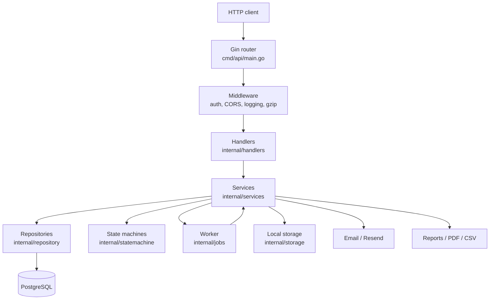

# Architecture Overview

Fintera API is a Go 1.27.3 REST backend for a real-estate contract management
system. It was migrated from Ruby on Rails and keeps the same `/api/v1`
contract, payment, user, reporting, and notification concepts.

## Technology stack

| Concern | Choice |
| --- | --- |
| Language | Go 1.27.3 |
| HTTP framework | Gin (`gin-gonic/gin`) |
| ORM | GORM with PostgreSQL (`gorm.io/driver/postgres`) |
| Database | PostgreSQL |
| Migrations | golang-migrate SQL files |
| Auth | JWT HS256 (`golang-jwt/jwt/v5`) + DB-backed refresh tokens |
| Authorization | Role checks in Gin middleware |
| State machines | `looplab/fsm` |
| Background work | In-process goroutine worker pool (`internal/jobs`) |
| File storage | Local filesystem (`internal/storage`) |
| Email | Resend (`resend-go/v2`) with embedded HTML templates |
| PDF generation | `gofpdf` (native, no external binary) |
| Spreadsheets | `excelize/v2` |
| Error tracking | Rollbar |
| Logging | `log/slog` wrapper (`pkg/logger`) |
| API docs | Swagger generated by `swag` into `docs/` |
| Config | Environment variables + `godotenv/autoload` |
| Validation | `go-playground/validator/v10` (used selectively) |

## Layered architecture



Dependency direction is one-way:

```
cmd/api → handlers → services → repository → models
                ↘ middleware        ↘ statemachine
                         ↘ jobs, storage, pkg/logger
```

- **Handlers** translate HTTP to service calls. They parse path/query/body,
  call one service method, and write the response. Keep them thin.
- **Services** hold business logic, transactions, state transitions,
  notifications, and background job enqueuing.
- **Repositories** own GORM queries and expose interfaces. Services depend on
  interfaces, not `*gorm.DB` (except `AuditService`, which receives `*gorm.DB`).
- **Models** contain GORM tags, status constants, helpers, and `ToResponse`
  DTO conversion.
- **Middleware** provides JWT authentication, role checks, CORS, request
  logging, and panic recovery.

## Application bootstrap

`cmd/api/main.go` wires everything manually; there is no DI framework:

1. `config.Load()` reads environment variables.
2. `logger.Setup(cfg.Environment)` configures structured logging.
3. Rollbar is configured when `ROLLBAR_TOKEN` is set, using
   `ROLLBAR_ENVIRONMENT` (falling back to `ENVIRONMENT`). Reporting is disabled
   when the token is empty, and payload keys matching credentials/session data
   are scrubbed.
4. `database.Connect(cfg.DatabaseURL)` opens GORM with a bounded pool.
5. `storage.NewLocalStorage(cfg.StoragePath)` ensures the storage root exists.
6. `repository.NewRepositories(db)` creates repository implementations.
7. `jobs.NewWorker(cfg.WorkerCount)` starts the background worker pool.
8. `services.NewServices(...)` creates all services with their dependencies.
9. `scheduleJobs(worker, svcs)` registers recurring jobs.
10. `handlers.NewHandlers(...)` creates HTTP handlers.
11. `setupRouter(...)` registers middleware and all routes.
12. A graceful HTTP server starts and waits for `SIGINT`/`SIGTERM`.
13. On shutdown: HTTP server, worker, then Rollbar flush. Fatal startup errors
    (database, storage, server bind) also flush Rollbar before `os.Exit`.

## Request lifecycle

1. Global middleware runs: Rollbar recovery (when configured), Gin recovery,
   request logger, CORS, gzip. The Rollbar middleware normalizes any panic value
   to an error and attaches method, path, route, IP, user agent, and (when
   authenticated) `user_id`/`user_role` before re-panicking to Gin recovery.
2. `/api/v1` group applies route-specific middleware:
   - public routes (health, auth, password recovery), or
   - `middleware.Auth` for protected routes, then role middleware.
3. Handler extracts `userID` / `userRole` via `middleware.GetUserID` /
   `GetUserRole` when needed.
4. Service performs validation, state transition, persistence, and side
   effects. Async notifications/emails go through `worker.EnqueueAsync`.
5. Handler serializes a model `ToResponse()` DTO or a small JSON envelope.

## Package map

| Path | Responsibility |
| --- | --- |
| `cmd/api` | Entry point, router setup, scheduled jobs, graceful shutdown |
| `cmd/test_email` | Manual email smoke-test command |
| `internal/config` | Environment configuration and defaults |
| `internal/database` | GORM connection, migrations, seeds |
| `internal/models` | GORM models, status constants, response DTOs |
| `internal/repository` | Data access interfaces and implementations |
| `internal/services` | Business logic, orchestration, reports, email |
| `internal/handlers` | Gin HTTP handlers |
| `internal/middleware` | JWT auth, RBAC, CORS, request logging |
| `internal/jobs` | Worker pool, scheduler, stats |
| `internal/statemachine` | Contract and payment FSMs |
| `internal/storage` | Local file storage and path safety |
| `internal/utils` | Placeholder package |
| `internal/mailers` | Placeholder package (email lives in services) |
| `internal/reports` | Placeholder package (reports live in services) |
| `pkg/logger` | `slog` setup and GORM logger adapter |
| `docs` | Generated Swagger package and OpenAPI files |
| `scripts` | Ad-hoc SQL maintenance scripts |
| `storage` | Runtime upload root (`contracts/`, `receipts/`, `uploads/`) |

## Cross-cutting concerns

- **Logging:** `pkg/logger` wraps `log/slog`. Production uses JSON; other
  environments use text. GORM logging is wired through `pkg/logger/gorm.go`.
- **Errors:** Handlers usually return `{"error": "<message>"}`. Many
  user-facing messages are Spanish. Service sentinel errors live in
  `internal/services/errors.go`.
- **CORS:** `middleware.CORS` uses `ALLOWED_ORIGINS` (comma-separated).
- **Compression:** gzip middleware is global.
- **Static files:** `/uploads` is served from `${STORAGE_PATH}/uploads` and
  `/receipts` from `${STORAGE_PATH}/receipts`, so payment `receipt_url` values
  resolve for anonymous tracking visitors.
- **Observability:** Rollbar captures panics and errors when configured; the
  worker exposes stats through `GET /api/v1/jobs/status` (admin only).

## Design decisions and trade-offs

- In-process jobs replace Solid Queue. Jobs are lost on restart, so recurring
  jobs use `ScheduleEveryImmediate` to run once after startup.
- Files are stored on local disk rather than object storage. Deployments need
  a persistent volume or files are lost on redeploy.
- JWT is intentionally Rails-compatible; tokens are accepted from the
  `Authorization: Bearer` header or a `?token=` query parameter for downloads.
- Audit logging is implemented in `AuditService`, not via ORM callbacks, so
  services must call it explicitly.

See [domain-flows.md](domain-flows.md) for behavior and
[api-and-auth.md](api-and-auth.md) for routes and authorization.
